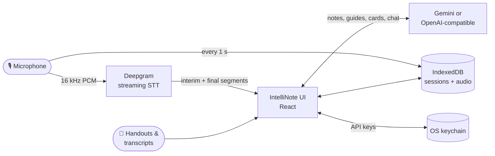

<div align="center">

# 🧠 IntelliNote 5000

### Your lectures, transcribed live and turned into study material.

Record a lecture, watch the transcript appear word by word, then get organized notes, a study guide, practice questions, and flashcards without leaving the app.

[](https://github.com/r3tr0hck342/IntelliNote5000/actions/workflows/ci.yml)


**macOS · Windows · Linux · Web** &nbsp;|&nbsp; iOS and Android in progress

</div>

---

## ✨ What it does

| | |
|---|---|
| 🎙️ **Live transcription** | **Free** with open-source Whisper (Groq's free tier or your own local server), or word-by-word with Deepgram. |
| 🤖 **Any AI you like** | **Free:** Gemini, OpenRouter `:free` models, Ollama (local). **Paid:** Claude, OpenAI, Mistral, DeepSeek, Grok. Pick any model, plus a stronger one for *Intelligence Mode*. |
| 📝 **Organized notes** | Turns the transcript plus any handouts into clean, editable rich-text notes. |
| 📚 **Study guide & test questions** | Summary, key concepts, outline, multiple-choice, short-answer, and essay questions. |
| 🃏 **Flashcards** | Choose how many cards you want, then flip through them in a built-in viewer. |
| 💬 **Chat with your lecture** | Ask questions answered only from your transcript and handouts. Gemini can also search the web. |
| ✏️ **AI transcript editing** | Improve readability, format as notes, pull out key topics, summarize a selection, or give your own instruction. |
| 📎 **Handouts** | Drop in PDF, DOCX, TXT, or MD files. They feed every AI feature. |
| 📥 **Transcript import** | Paste or upload `.txt`/`.md`. SRT/VTT cues and `[00:12:03]` timestamps are detected automatically. |
| 🏷️ **Tags & search** | AI-suggested tags, plus sidebar search by title, date, or tag. |
| 🌗 **Dark & light themes** | Dark by default, with no flash on load. |

## 🛡️ Built not to lose your work

- **Audio is saved every second** to local storage while you record. A crash or a closed window keeps everything up to that point.
- **No 5 MB browser cap.** Sessions and recordings live in IndexedDB, and existing data migrates automatically.
- **Dropped connection? Recording keeps going.** Streaming reconnects with exponential backoff. If it can't reconnect, **Transcribe After Recording** processes the saved audio instead.
- **Download audio** for any live recording, through the native save dialog on desktop.
- **Loud failures.** If a load or save fails, you get an error toast, and saving pauses rather than overwrite good data.
- **Interruptions handled.** Unplugging the mic, a mute, or switching apps pauses recording and resumes it when possible.

## 🔐 Your keys, your data

- **Bring your own API keys.** No IntelliNote account and no IntelliNote server: requests go straight from your device to the provider.
- **Keys live in the OS keychain**: the macOS Keychain or equivalent through Tauri, and iOS Keychain or Android Keystore through Capacitor. On the web, browser storage is **opt-in**.
- **Logs are redacted.** API keys and tokens are stripped before anything is logged or exported.
- **Hardened desktop shell**: a strict Content Security Policy with no inline scripts, least-privilege Tauri permissions, and AI chat replies rendered as plain text, never as HTML.

## 🧩 How it fits together



**Transcription**

| Provider | Cost | How it works |
|---|---|---|
| **Whisper** via [Groq](https://console.groq.com) | 🆓 free tier | Open-source Whisper in the cloud; live text every ~8 s |
| **Whisper** on your machine ([speaches](https://github.com/speaches-ai/speaches)) | 🆓 free, offline | `docker run -p 8000:8000 ghcr.io/speaches-ai/speaches:latest-cpu`, then pick the *Local* preset |
| **Deepgram** | paid (starter credit) | True word-by-word streaming |

**AI (notes, guides, flashcards, chat)**

| Provider | Cost | Default models (normal / Intelligence Mode) |
|---|---|---|
| **Google Gemini** | 🆓 free tier | `gemini-flash-lite-latest` / `gemini-2.5-pro` · web-grounded chat |
| **OpenRouter** | 🆓 `:free` models | `meta-llama/llama-3.3-70b-instruct:free` / `deepseek/deepseek-chat-v3-0324:free` |
| **Ollama** | 🆓 local, offline | `llama3.2` / `llama3.1:8b` |
| **Anthropic Claude** | paid | `claude-opus-5-5` (Intelligence Mode raises effort) · Sonnet 5.5, Haiku 5.5, Fable 5.1 available |
| **OpenAI** | paid | `gpt-4o-mini` / `gpt-4o` · custom base URL for proxies |
| **Mistral · DeepSeek · xAI Grok** | paid | `mistral-small` / `mistral-large` · `deepseek-chat` / `deepseek-reasoner` · `grok-3-mini` / `grok-3` |

Every provider accepts **any model ID** you type, so new models work without an app update. On desktop, requests go through Tauri's Rust HTTP client, so self-hosted and custom endpoints work there too.

---

## 🚀 Quick start

**You need:** Node.js 20.19+ and npm 10+. For the desktop app, also the Rust toolchain (1.77.2+).

```bash
git clone https://github.com/r3tr0hck342/IntelliNote5000.git
cd IntelliNote5000
npm install
npm run dev            # → http://localhost:1420
```

Then, in the app:

1. Open **⚙️ Settings → AI Provider** and pick one. Free options: a [Gemini key](https://aistudio.google.com/apikey), an [OpenRouter key](https://openrouter.ai/keys), or [Ollama](https://ollama.com) with no key at all.
2. Open **Settings → Transcription Provider**, pick **Whisper (open source)**, and paste a free [Groq key](https://console.groq.com/keys), or choose the *Local* preset for your own Whisper server.
3. Click **New Live Lecture**, allow mic access, and start talking.

> [!TIP]
> No keys yet? Turn on **Settings → Diagnostics** and run **Dry-run Import Pipeline**. It checks the whole AI pipeline end to end without calling any provider.

<details>
<summary><b>Optional: pre-fill keys for local development</b></summary>

```bash
cp .env.example .env.local
```

Set `VITE_API_KEY`, `VITE_AI_PROVIDER`, and `VITE_AI_BASE_URL`, plus `VITE_STT_API_KEY`, `VITE_STT_LANGUAGE`, and `VITE_STT_MODEL`. These are dev-only fallbacks; shipped apps always use the Settings screen.
</details>

### Run the desktop app

```bash
npm run start-desktop  # Tauri dev window
```

On Linux, first install: `sudo apt install libwebkit2gtk-4.1-dev libappindicator3-dev librsvg2-dev patchelf libdbus-1-dev`

---

## 📦 Building & releasing

**Easiest way to get installers:** push a tag, and GitHub Actions builds unsigned macOS, Windows, and Linux installers and attaches them to a draft release.

```bash
git tag v0.2.0 && git push origin v0.2.0
```

<details>
<summary><b>🍎 macOS (local)</b></summary>

```bash
npm run tauri:build:unsigned   # ad-hoc signed test build
npm run tauri:build:signed     # Developer ID + notarization
npm run package:mac:test       # zip + dmg + checksums + tester README → dist/testers/
```

Signed builds need `TAURI_MACOS_SIGNING_IDENTITY` and `TAURI_MACOS_PROVIDER_SHORT_NAME`. Notarization also needs `APPLE_ID`, `APPLE_PASSWORD` (app-specific), `APPLE_TEAM_ID`, and `TAURI_NOTARIZE=1`. Output goes to `src-tauri/target/release/bundle/`.

Unsigned builds: right-click → **Open**, or **System Settings → Privacy & Security → Open Anyway**.

Full guide: [Apple release checklist](docs/apple-release-checklist.md)
</details>

<details>
<summary><b>📱 iOS & Android (Capacitor)</b></summary>

> [!NOTE]
> `ios/` and `android/` currently hold only the permission files. Generate the full native projects first. See [Phase 2 of the roadmap](docs/distribution-roadmap.md#phase-2-phones--12-weeks-after-phase-1).

```bash
npm run native:ios:gen && npm run native:ios:open          # then archive in Xcode
npm run native:android:gen && npm run native:android:open  # then build in Android Studio
npm run android:bundle:release                              # AAB
```
</details>

<details>
<summary><b>🌐 Web</b></summary>

```bash
npm run build   # deploy dist/ to any static host (HTTPS required for the mic)
```
</details>

---

## 🔬 Diagnostics

Turn on **Settings → Diagnostics & Storage → Diagnostics panel** to get:

- **Live event log** with level filtering and keys redacted.
- **10-second STT probe**: time to first interim and final result, event cadence, reconnects, and dropped audio frames.
- **Dry-run import pipeline**: runs every AI stage with no network calls.
- **Export diagnostics bundle**: a redacted JSON file with build info, platform, logs, and probe results. Attach it to bug reports.
- **Reset app state**: clears sessions and settings, and optionally your saved keys.

Every build has a label, e.g. `IntelliNote5000 0.1.0 (37de5c7)`, shown in **Settings → About**. Include it in bug reports.

---

## 🛠️ Development

| Command | What it does |
|---|---|
| `npm run dev` | Vite dev server on port 1420 |
| `npm test` | Unit, transcript-pipeline, and storage (IndexedDB) tests |
| `npm run typecheck` | `tsc --noEmit` |
| `npm run lint` | ESLint |
| `npm run build` | Production web bundle |
| `npm run verify:release` | Checks native permission strings, entitlements, and env wiring |
| `npm run verify:platforms` | Pre-packaging platform config check |
| `npm run verify:providers` | Validates AI provider metadata |

**CI** runs lint, typecheck, tests, build, release verification, and a Rust `cargo check` on every PR and on every push to `main`. **Dependabot** opens one grouped PR per ecosystem each month; major version bumps are left for manual upgrades.

<details>
<summary><b>Project layout</b></summary>

```
App.tsx                 app state, session lifecycle, AI pipeline
components/             UI: MainPanel, LiveNoteTaker, Settings, Diagnostics…
services/providers/     AI adapters (Gemini, OpenAI) + error mapping
services/stt/           Deepgram streaming + prerecorded transcription, probe
utils/                  storage (IndexedDB, keychain), transcript parsing, logging
src-tauri/              desktop shell: keychain commands, mic permissions, CSP
verification_scripts/   tests + platform checks
tools/                  build label, release and packaging scripts
```

**Adding an AI provider:** write an adapter in `services/providers/` that implements `AiProvider`, register it in `services/providers/index.ts`, and run `npm run verify:providers`.
</details>

---

## 🩺 Troubleshooting

<details>
<summary><b>AI requests fail</b></summary>

Open the Diagnostics panel and check the error code. `auth_failed` means re-save or regenerate your key. `rate_limited` means wait and use the **Retry** button on the toast.
</details>

<details>
<summary><b>Live transcription won't connect</b></summary>

- **Whisper:** check the endpoint and key in Settings. For a local server, make sure it's running (`curl http://localhost:8000/v1/models`). Text appears every ~8 seconds, not word by word.
- **Deepgram:** check your key and that your network allows WebSockets to `api.deepgram.com`.
- Run the **10-second STT probe** in Diagnostics to see where it fails.
</details>

<details>
<summary><b>Microphone blocked</b></summary>

- **Browser:** check the site permissions; the mic needs HTTPS.
- **macOS:** System Settings → Privacy & Security → Microphone.
- **Linux desktop:** the app enables WebKitGTK media streams automatically. Make sure PipeWire or PulseAudio sees your mic.
</details>

<details>
<summary><b>Keys don't persist in the browser</b></summary>

By design. Turn on **Settings → Allow browser storage fallback** to keep keys in localStorage on web builds.
</details>

<details>
<summary><b>Interim text stops updating</b></summary>

Keep the app in the foreground. Recording auto-pauses when the window is hidden and resumes when you come back.
</details>

---

## 🗺️ Roadmap

Desktop ships first, then phones, then a tablet layout. Planned items include backup export and import, auto-updates, signed installers, and a first-run setup screen. See **[docs/distribution-roadmap.md](docs/distribution-roadmap.md)**.

<div align="center">
<sub>Built with React, Tauri, and Capacitor · free with Whisper + Gemini, OpenRouter, or Ollama</sub>
</div>
